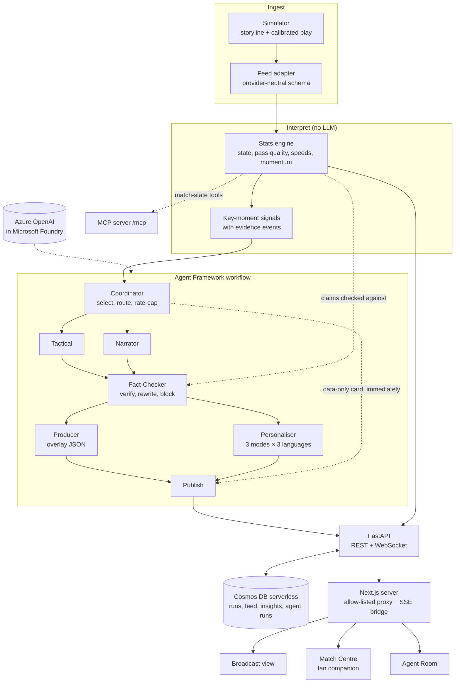

# Matchlens

**Live match intelligence, explained as it happens.**

Matchlens is a multi-agent match-insights engine on Azure. It ingests football events as they happen, works out
what matters and why, checks every claim against the data, and publishes each insight twice: as timed broadcast
overlays for a studio, and as a personalised companion feed for every fan, in their mode, club, player and
language.

Fans can ask the Pundit anything about the match and get grounded answers that link to the moments they cite.
Coaches get the Tactics Brain: state a goal in plain words, and agents propose ideas, the simulator plays each one
10 seconds forward, and a tactical model ranks them by the chance of a shot, a goal or conceding. The whole
experience runs on synthetic match data.

Built for the Microsoft Premier League Hackathon (October 2026) with Azure OpenAI, Azure AI Speech and MAI-Voice,
Cosmos DB and Azure Container Apps. Clubs, players, venues and competitions in the synthetic match experience are
fictional. The optional historical league warehouse stays local and separate; see [Data policy](#data-policy).

> **Demo video (2 min):** <https://youtu.be/cgJjoJ6LpYI>
>
> **Live demo:** <https://ca-frontend-7npbct7a7fan6.grayfield-727b5fb5.centralindia.azurecontainerapps.io>
> (Azure Container Apps, deployed from `main` by GitHub Actions). Every visitor watches the same live match, so
> restarting or switching it changes it for everyone.

## What it does

| Stage | What happens | Where |
|---|---|---|
| **Ingest** | A simulator calibrated on real match statistics plays a 90-minute match from a scripted storyline. A pluggable feed adapter streams events and 1 Hz tracking in a provider-neutral schema, handling duplicates, late events and corrections. | `simulator/`, `ingest/` |
| **Interpret** | A deterministic stats engine (no language model) keeps score, clock, possession and player/team stats, rates every pass's difficulty, computes speeds, distance and rolling momentum, and detects key moments. | `interpret/` |
| **Explain** | A coordinator picks the moments worth explaining. Tactical and Narrator agents say why they matter, with evidence. A Fact-Checker verifies every claim against the stats engine and rewrites or blocks anything unsupported. | `agents/`, `factcheck/` |
| **Render** | A Producer agent turns each insight into timed overlay JSON with priority and screen slot; a scheduler caps what is on screen. The broadcast view plays them over a live 2D pitch. | `agents/producer.py`, `frontend/src/features/broadcast/` |
| **Personalise** | A Personaliser agent writes every insight for Casual, Analyst and Player-Focus modes in English, Hindi and Spanish, plus each club's angle. Fans also get "What did I miss?" catch-ups and half-time and full-time recaps. | `agents/services.py`, `frontend/src/features/companion/` |
| **Coach** | Short ranked tactical briefs, each with its evidence, trade-off and confidence, fact-checked like every other insight. | `agents/`, `frontend/src/features/coach/` |
| **Tactics Brain** | The coach states a goal in plain words. Tactician agents propose ideas, the simulator plays each one forward from the current moment, and a tactical model scores where the ball goes next and the chance of a shot, goal, turnover or conceding. Ideas come back ranked with their risk and evidence. The learned model (a GATv2 critic ensemble with uncertainty and a cVAE that proposes repositionings) is documented in the [model card](docs/TACTICSML.md); without its weights, the board uses a pitch-control and expected-threat baseline. | `tactics/`, `tacticsml/`, `agents/tactician.py`, `frontend/src/features/tactics/` |
| **Engage** | Fan polls open at key moments and resolve against what happened. Every player gets a rating from the data next to the fans' rating, and a match card (overall and six attributes) computed from this match alone. Insights can be read aloud with Azure AI Speech. | `runtime/fans.py`, `interpret/ratings.py`, `speech.py`, `frontend/src/features/fans/` |
| **Replay** | Any key moment can be watched back on the monitor with telestrator strokes (passing lanes, carries, the shot and its speed, pressing zones) worked out from the stats engine. Goals get a full-frame call and roll straight into their replay. The Match Pulse strip shows the match minute by minute (momentum, control or chaos, pressing), with every key moment pinned. | `interpret/moments.py`, `interpret/pulse.py`, `frontend/src/features/broadcast/` |
| **Ask the Pundit** | Fans ask about the match in English, Hindi or Spanish. Each answer is built from a data pack the engine prepares, fact-checked, and links to the moments it cites. | `agents/pundit.py`, `frontend/src/features/pundit/` |
| **Multiverse** | Four fans, one match, side by side: each screen is the same live feed told for a different person and language. | `frontend/src/features/multiverse/` |
| **Scenario Lab** | Pick a scripted match or describe one; the simulator checks it can be played, kicks it off, and tracks each scripted moment against what the engine saw. The running match downloads as a dataset. | `simulator/scenarios.py`, `agents/scenario.py`, `frontend/src/features/lab/` |
| **Archive** | Every match is stored. Reopen one later: a match cut off part-way resumes, a finished one opens as it ended. | `runtime/manager.py`, `frontend/src/features/replay/` |
| **Video (local)** | A vision pipeline turns match footage into the same events and tracking, scored against hand labels. Developer-machine only; see [Video auto-eventing](#video-auto-eventing). | `vision/` |

## Architecture



- **The live feed never waits for a model.** Score, clock, timeline and a data-only insight card publish as soon as
  the stats engine sees an event. The agent workflow then upgrades the same insight and overlay in place. A failed
  or slow agent falls back to the data-only text, and an agent failure never stops the feed (BRD §8.3).
- **Claims are checked against the engine.** Agents return structured claims alongside their text. The
  Fact-Checker verifies each claim against the stats engine and flags any number no fact accounts for. It allows one
  rewrite; if problems remain, the agent text is blocked and the verified data-only text is shown. Every insight
  carries its evidence event ids, the agents involved and the fact-check report. The report states its
  verification scope: structured claims and numeric guards do not establish every assertion in free-form prose.
- **Corrections flow everywhere.** When the feed corrects an event, the engine replays the match, updates every
  affected statistic and signal, re-explains changed moments and retracts insights that no longer hold.
- **Nothing lives only in memory.** Every event, frame, signal, insight, overlay, coordinator decision, agent run and
  fan catch-up is written to Cosmos DB (serverless) behind a write-behind queue, and read through an in-process cache.
  A restarted backend can resume a supported synthetic run from its stored feed. Recovery is best effort during
  persistent write failures, and custom storylines have resume limitations. See
  [docs/DATABASE.md](docs/DATABASE.md).
- **Cost-aware.** The coordinator rate-caps agent runs; frequent tasks use the fast model and recaps the strong one.
  A recorded demo match replays every agent answer, so judges get instant, repeatable output with no model calls.

Azure hosting (two Container Apps, managed identity, scale to zero) is described in
[docs/DEPLOY.md](docs/DEPLOY.md).

## Quick start

Prerequisites: [uv](https://docs.astral.sh/uv/) (Python 3.12 is installed automatically) and Node.js 20.9 or later.

```bash
npm install
```

```bash
npm run setup
```

```bash
npm run dev:demo
```

Open <http://localhost:3000>. The backend runs on port 8765 and starts the hero match at real time; use the replay
controls to speed it up (up to 60x), pause it, or restart it from any minute.

| Page | Path | For |
|---|---|---|
| Live | `/` | Fans: match pitch, personalised moments, catch-up and pundit |
| Moments | `/moments` | Highlights, timeline, evidence and recap |
| Stats | `/stats` | Team and player statistics, shot map and fan ratings |
| Coach | `/coach` | Team-specific briefs, lineup, stats, report and Tactics Board |
| Explore | `/explore` | Broadcast, Multiverse, Scenario Lab and replay/archive settings |
| Broadcast | `/explore/broadcast` | Studio: clean full-width pitch with timed overlays; `/broadcast` redirects here |
| Agent Room | `/agents` | Developer view of routing decisions, fact-check results and latency |

### Run modes

| Command | Agents answer from | Needs Azure |
|---|---|---|
| `npm run dev:demo` | The recorded demo match (`backend/demo/hero-match.json`), data-only templates for anything not recorded | No |
| `npm run dev:offline` | Data-only templates (the full workflow still runs) | No |
| `npm run dev` | Azure OpenAI, live | Yes |
| `npm run dev:db` | Like `dev:demo`, but stores runs in the local Cosmos DB emulator (start it first with `npm run db:emulator`) | No (Docker) |

Without `MATCHLENS_COSMOS_ENDPOINT` the backend uses an in-memory store and logs a warning; set it to persist runs
(see [docs/DATABASE.md](docs/DATABASE.md)).

For live models, copy `backend/.env.example` to `backend/.env`, set `AZURE_OPENAI_ENDPOINT` to your Azure OpenAI
(Foundry) endpoint with a `gpt-5-mini` deployment, and run `az login`. Authentication uses Entra ID, so there are no
API keys. Other settings (`MATCHLENS_SPEED`, `MATCHLENS_SEED`, model names, reasoning effort, timeouts) are listed
in [`backend/.env.example`](backend/.env.example).

Voice narration uses Azure AI Speech when `MATCHLENS_SPEECH_REGION` and `MATCHLENS_SPEECH_RESOURCE_ID` are set (also
Entra ID, no keys); without them the browser's own voices read the insights.

### Tests and checks

```bash
npm test
```

```bash
npm run lint
```

The backend tests cover the simulator and its calibration, the feed adapters, the stats engine (duplicates,
out-of-order events, corrections), the fact-checker (wrong claims rewritten, unfixable ones blocked), the agent
workflow end to end, the recorded demo, and that every published overlay and insight validates against the
documented schema.

## Video auto-eventing

`backend/src/matchlens/vision/` turns a match video into Matchlens events and tracking: it maps the camera's pixels to
pitch metres, detects and tracks players (RT-DETR on tiles of the frame, then a ByteTrack-style tracker), splits them
into teams by kit colour, and reads passes, carries, tackles, interceptions, shots and restarts from who has the
ball. The result plays like any other match from the Past matches card.

It is built and measured on [SoccerTrack v2](https://github.com/AtomScott/SoccerTrack-v2) research footage
(CC BY 4.0, [dataset](https://huggingface.co/datasets/atomscott/soccertrack-v2)). That footage, its labels and everything derived from it stay in `backend/data/local/` (gitignored): none
of it is in this repository, the deployed demo or the demo video, and a match built from it is shown as the fictional
Westmoor v Eastbrook (BRD §6.3).

Measured on a 4-minute clip of match 128057 (from the first-half kick-off), against the dataset's hand labels:

| What | Result |
|---|---|
| Pitch calibration | median 0.9 m error (leave-one-out over 65 surveyed points) |
| Team split | every player on the right team; both keepers found |
| Player detection and tracking (first 20 s) | 96% recall, 90% precision, MOTA 0.86 |
| Ball detection (first 20 s) | within 3 m on 40% of in-play frames |
| Passes | 46% recall, 51% precision (±1 s, same team) |
| Carries | 23% recall, 50% precision |
| Shot, throw-ins, free kick | all found |

The events above still use the dataset's player identities and ball track. Joining the detector's broken tracks
into whole players and driving events from the detected ball are the next steps (BRD §6.2).

```bash
cd backend && uv sync --group vision
```

```bash
cd backend && uv run --group vision python -m matchlens.vision 128057 --detect 20
```

The first run with `--detect` downloads the RT-DETR weights (`PekingU/rtdetr_r50vd`, Apache-2.0, about 172 MB).

### Broadcast footage: main camera and per-frame calibration

TV footage cuts between cameras and its main camera pans and zooms, so one fixed calibration no longer works. The
first step towards it:

- **Main camera only** (`views.py`): cuts are found from jumps in the colour histogram, and each shot is kept only
  if most of its frames are mostly grass with nothing large standing on it. Close-ups, other angles and the crowd
  are set aside. Replays from the main camera's angle are not caught yet.
- **A homography per frame** (`camera.py`): one hand-labelled frame starts it. Corners tracked on the pitch carry it
  from frame to frame, and each frame is then fitted to its painted lines both ways (markings onto paint, paint onto
  markings), which stops drift. After a cut it finds its way back through keyframes it saved earlier.

On synthetic footage (a textured pitch filmed by a known panning and zooming camera, with a cut away and back), every
main-camera frame is calibrated with a median error of 1.4 px (0.26 m). That is measured against labels that
themselves carry about 1 px of click noise. It has not been measured on real broadcast footage yet.

Put a clip in `backend/data/local/broadcast/clips/` (gitignored), label 15 to 20 frames, then run and measure:

```bash
cd backend && uv run --group vision python -m matchlens.vision.label
```

```bash
cd backend && uv run --group vision python -m matchlens.vision.broadcast --overlay
```

Use only footage you have the right to use. Like the SoccerTrack data, it and everything made from it stay in
`backend/data/local/`.

## Data policy

**At run time, everything is synthetic.** The deployed app and the demo video only show matches the simulator
generates, between fictional clubs and players: the hero match, the open [dataset/](dataset/), Scenario Lab
matches and the fictional synthetic season. No real match data is served, stored in Cosmos DB, or shipped in the
container images.

**Real open data is used only on a developer's machine, for research and calibration, and is never redistributed.**
Downloads and everything built from them stay under `backend/data/local/`, which is gitignored. That covers the
league warehouse, the tactics-model training shards and weights, and video footage with its labels. What this
repository does contain from real data is aggregate only:

- the simulator's calibration averages over 100 real top-flight matches, in `dataset/`;
- the expected-threat grid fitted to StatsBomb open event data (`backend/src/matchlens/tacticsml/xt_grid.json`).

| Used for | Source | Licence and attribution |
|---|---|---|
| Simulator calibration, expected-threat grid, tactics-model training | [StatsBomb Open Data](https://github.com/statsbomb/open-data) (events and 360 frames) | StatsBomb open-data user agreement. Data provided by StatsBomb |
| Tactics-model training | DFL / IDSSE open tracking and event data | CC BY 4.0. Bassek et al., *Scientific Data* 12, 195 (2025) |
| Tactics-model training | [SkillCorner open data](https://github.com/SkillCorner/opendata) | MIT, copyright SkillCorner |
| Tactics-model training (parity check) | [Metrica Sports sample data](https://github.com/metrica-sports/sample-data) | CC BY-NC 4.0, Metrica Sports. The trained weights are therefore for non-commercial use |
| Video auto-eventing (local) | [SoccerTrack v2](https://github.com/AtomScott/SoccerTrack-v2) | CC BY 4.0 |
| Player detection (local) | [RT-DETR](https://huggingface.co/PekingU/rtdetr_r50vd) weights, downloaded on first use | Apache-2.0 |
| League warehouse for the Tactics Brain (local) | Understat, football-data.co.uk, ClubElo, Transfermarkt datasets, Fantasy Premier League, openfootball, Wikidata, Wikipedia | Per source; see [docs/LEAGUEDATA.md](docs/LEAGUEDATA.md#sources-and-licences) |

The Tactics Brain is the one feature allowed to reason with real club and player names (BRD §9.3 amendment), and
only on a developer's machine with a locally built warehouse. The deployed app has no warehouse and stays fictional.

## Data and schemas

- **[docs/DATABASE.md](docs/DATABASE.md):** the Cosmos DB containers, write and read paths, cache, resuming after a
  restart, and cost.
- **[docs/SCHEMA.md](docs/SCHEMA.md):** the event, tracking, overlay and insight contracts, the REST API and the
  WebSocket stream. Machine-readable JSON Schemas are in [docs/schema/](docs/schema/).
- **[dataset/](dataset/):** the open synthetic dataset: five full matches (the hero demo match and four unscripted
  ones) with events, 1 Hz tracking, metadata and the simulator's calibration against real match statistics.
  Regenerate it with `npm run export:dataset`.
- **[Synthetic seasons](docs/SYNTHETIC_SEASONS.md):** read local 2024–25/2023–24 population aggregates, independently
  generate a fictional multi-match season under ignored data paths, preview it, then explicitly seed completed
  archives into a local Cosmos emulator. Real match records are not imported.
- **Calibration:** the simulator is tuned against aggregate statistics of 100 real top-flight matches (passing
  lengths and completion, pressure, shot locations, xG, set pieces, fouls and cards). Only the averages are kept;
  no real names or match data are used. Real-data calibration:
  [StatsBomb Open Data](https://github.com/statsbomb/open-data), data provided by StatsBomb.

## Repository layout

```text
backend/                 Python 3.12, FastAPI, Microsoft Agent Framework
  src/matchlens/
    domain/              provider-neutral schema (events, tracking, match metadata)
    simulator/           match simulator, storylines, fictional roster, calibration
    ingest/              feed adapters (synthetic replay, JSON lines)
    interpret/           stats engine, pass quality, momentum, key-moment signals
    agents/              coordinator, agent workflow, prompts, fallbacks, recorded demo
    factcheck/           claim verification
    tools/, mcp_server/  match-state tools and the MCP server
    runtime/             live match session, pub/sub, run start and resume
    store/               Cosmos DB store, write-behind queue, read-through cache
    vision/              video auto-eventing: calibration, detection, tracking, teams, events
    dataset/             open dataset export and JSON Schema generation
    api/                 REST and WebSocket API
  tests/
  demo/hero-match.json   recorded agent answers for the hero match
frontend/                Next.js, TypeScript, Tailwind, shadcn/ui, TanStack Query, Zustand, React Flow
dataset/                 open synthetic dataset
docs/                    BRD, schema reference, deployment guide
infra/                   Bicep for Azure Container Apps and Cosmos DB (azd up)
```

## Technology

| Layer | Technology |
|---|---|
| Backend | Python 3.12, FastAPI, WebSockets, Pydantic |
| Agents | Microsoft Agent Framework workflows |
| Models | Azure OpenAI in Microsoft Foundry (`gpt-5-mini`), Entra ID authentication |
| Tools | MCP server for match state |
| Database | Azure Cosmos DB for NoSQL (serverless), managed identity |
| Frontend | Next.js (App Router), TypeScript, Tailwind CSS, shadcn/ui, Motion, Recharts, React Flow |
| Voice | MAI-Voice narration and Azure AI Speech, browser speech synthesis as fallback |
| Vision (local only) | PyTorch, RT-DETR (Transformers), OpenCV, SciPy |
| Hosting | Azure Container Apps, Azure Container Registry, Cosmos DB, managed identity, Log Analytics |
| Infrastructure as code | Bicep with the Azure Developer CLI |
| CI/CD | GitHub Actions: backend, frontend, image and Bicep checks on every pull request; deploys `main` with OIDC (no stored secrets) |

## License

The code is released under the [MIT License](LICENSE). Third-party data, model weights and fonts keep their own
licences; see [Data policy](#data-policy).
