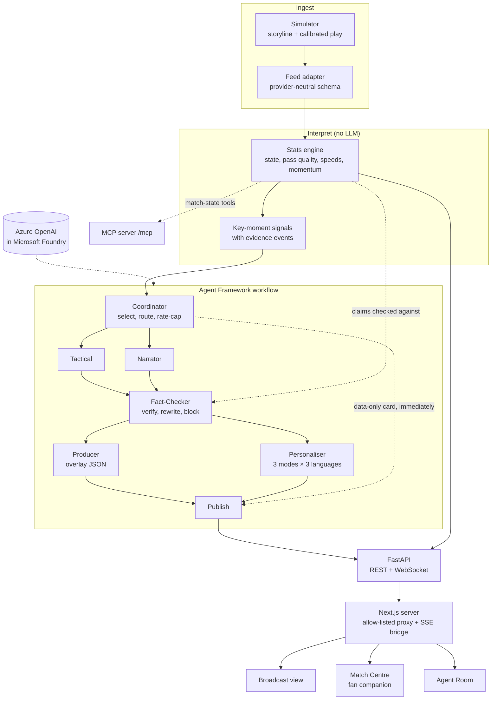

# Matchlens

**Live match intelligence, explained as it happens.**

Matchlens is a multi-agent match-insights engine on Azure. It ingests football events as they happen, works out
what matters and why, checks every claim against the data, and publishes each insight twice: as timed broadcast
overlays for a studio, and as a personalised companion feed for every fan, in their mode, club, player and
language.

Built for the Microsoft Premier League Hackathon (October 2026). Every club, player, venue and competition is
fictional.

> **Demo link:** to be added after deployment (see [docs/DEPLOY.md](docs/DEPLOY.md)).

## What it does

| Stage | What happens | Where |
|---|---|---|
| **Ingest** | A calibrated simulator plays a 90-minute match from a scripted storyline. A pluggable feed adapter streams events and 1 Hz tracking in a provider-neutral schema, handling duplicates, late events and corrections. | `simulator/`, `ingest/` |
| **Interpret** | A deterministic stats engine (no language model) keeps score, clock, possession and player/team stats, rates every pass's difficulty, computes speeds, distance and rolling momentum, and detects key moments. | `interpret/` |
| **Explain** | A coordinator picks the moments worth explaining. Tactical and Narrator agents say why they matter, with evidence. A Fact-Checker verifies every claim against the stats engine and rewrites or blocks anything unsupported. | `agents/`, `factcheck/` |
| **Render** | A Producer agent turns each insight into timed overlay JSON with priority and screen slot; a scheduler caps what is on screen. The broadcast view plays them over a live 2D pitch. | `agents/producer.py`, `frontend/src/features/broadcast/` |
| **Personalise** | A Personaliser agent writes every insight for Casual, Analyst and Player-Focus modes in English, Hindi and Spanish, plus each club's angle. Fans also get "What did I miss?" catch-ups and half-time and full-time recaps. | `agents/services.py`, `frontend/src/features/companion/` |

## Architecture



- **The live feed never waits for a model.** Score, clock, timeline and a data-only insight card publish as soon as
  the stats engine sees an event. The agent workflow then upgrades the same insight and overlay in place. A failed
  or slow agent falls back to the data-only text, and an agent failure never stops the feed (BRD §8.3).
- **Only facts from the engine reach the screen.** Agents return structured claims alongside their text. The
  Fact-Checker verifies each claim against the stats engine and flags any number no fact accounts for. It allows one
  rewrite; if problems remain, the agent text is blocked and the verified data-only text is shown. Every insight
  carries its evidence event ids, the agents involved and the fact-check report.
- **Corrections flow everywhere.** When the feed corrects an event, the engine replays the match, updates every
  affected statistic and signal, re-explains changed moments and retracts insights that no longer hold.
- **Cost-aware.** The coordinator rate-caps agent runs; frequent tasks use the fast model and recaps the strong one.
  A recorded demo match replays every agent answer, so judges get instant, repeatable output with no model calls.

Azure hosting (two Container Apps, managed identity, scale to zero) is described in
[docs/DEPLOY.md](docs/DEPLOY.md).

## Quick start

Prerequisites: [uv](https://docs.astral.sh/uv/) (Python 3.12 is installed automatically) and Node.js 20.9 or later.

```bash
npm install
```

```bash
npm run setup
```

```bash
npm run dev:demo
```

Open <http://localhost:3000>. The backend runs on port 8765 and starts the hero match at real time; use the replay
controls to speed it up (up to 60x), pause it, or restart it from any minute.

| Page | Path | For |
|---|---|---|
| Match Centre | `/` | Fans: broadcast feed, personalised insights, timeline, stats, catch-up and recap |
| Broadcast | `/broadcast` | Studio: full-width pitch with timed overlays |
| Agent Room | `/agents` | The agent pipeline live: routing decisions, fact-check results, latency |

### Run modes

| Command | Agents answer from | Needs Azure |
|---|---|---|
| `npm run dev:demo` | The recorded demo match (`backend/demo/hero-match.json`), data-only templates for anything not recorded | No |
| `npm run dev:offline` | Data-only templates (the full workflow still runs) | No |
| `npm run dev` | Azure OpenAI, live | Yes |

For live models, copy `backend/.env.example` to `backend/.env`, set `AZURE_OPENAI_ENDPOINT` to your Azure OpenAI
(Foundry) endpoint with a `gpt-5-mini` deployment, and run `az login`. Authentication uses Entra ID, so there are no
API keys. Other settings (`MATCHLENS_SPEED`, `MATCHLENS_SEED`, model names, reasoning effort, timeouts) are listed
in [`backend/.env.example`](backend/.env.example).

### Tests and checks

```bash
npm test
```

```bash
npm run lint
```

The backend tests cover the simulator and its calibration, the feed adapters, the stats engine (duplicates,
out-of-order events, corrections), the fact-checker (wrong claims rewritten, unfixable ones blocked), the agent
workflow end to end, the recorded demo, and that every published overlay and insight validates against the
documented schema.

## Data and schemas

- **[docs/SCHEMA.md](docs/SCHEMA.md):** the event, tracking, overlay and insight contracts, the REST API and the
  WebSocket stream. Machine-readable JSON Schemas are in [docs/schema/](docs/schema/).
- **[dataset/](dataset/):** the open synthetic dataset: five full matches (the hero demo match and four unscripted
  ones) with events, 1 Hz tracking, metadata and the simulator's calibration against public match averages.
  Regenerate it with `npm run export:dataset`.

## Repository layout

```text
backend/                 Python 3.12, FastAPI, Microsoft Agent Framework
  src/matchlens/
    domain/              provider-neutral schema (events, tracking, match metadata)
    simulator/           match simulator, storylines, fictional roster, calibration
    ingest/              feed adapters (synthetic replay, JSON lines)
    interpret/           stats engine, pass quality, momentum, key-moment signals
    agents/              coordinator, agent workflow, prompts, fallbacks, recorded demo
    factcheck/           claim verification
    tools/, mcp_server/  match-state tools and the MCP server
    runtime/             live match session and pub/sub
    dataset/             open dataset export and JSON Schema generation
    api/                 REST and WebSocket API
  tests/
  demo/hero-match.json   recorded agent answers for the hero match
frontend/                Next.js, TypeScript, Tailwind, shadcn/ui, TanStack Query, Zustand, React Flow
dataset/                 open synthetic dataset
docs/                    BRD, schema reference, deployment guide
infra/                   Bicep for Azure Container Apps (azd up)
```

## Technology

| Layer | Technology |
|---|---|
| Backend | Python 3.12, FastAPI, WebSockets, Pydantic |
| Agents | Microsoft Agent Framework workflows |
| Models | Azure OpenAI in Microsoft Foundry (`gpt-5-mini`), Entra ID authentication |
| Tools | MCP server for match state |
| Frontend | Next.js (App Router), TypeScript, Tailwind CSS, shadcn/ui, Motion, Recharts, React Flow |
| Hosting | Azure Container Apps, Azure Container Registry, managed identity, Log Analytics |
| Infrastructure as code | Bicep with the Azure Developer CLI |
