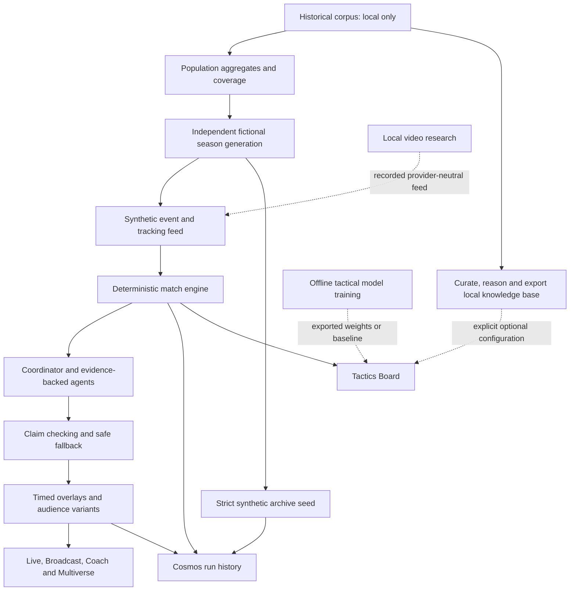

# Matchlens application and hackathon review

Reviewed on 27 October 2026 on `ui-redesign-codex`, based on `ui-redesign` at `afbea45`. This document connects the detailed [backend review](backend-review-and-plan.md), [UI research](ui-research.md), [removal audit](frontend-removals-and-changes.md) and independent UI review. Implementation and final validation results are recorded below.

## What happened to Broadcast

Broadcast was moved, not deleted. The redesign put it at `/explore/broadcast` and retained the `/broadcast` redirect. Its design specification explicitly required coach mode to hide Broadcast, Multiverse, polls and fan voting (`docs/redesign/design-spec.md`, coach-mode rule). Explore therefore lost its Broadcast tile whenever the persisted coach preference was on. This branch removes that gate for Broadcast and Multiverse, adds Broadcast access on Live and in search, and repairs Explore's replay entry so it opens Stream settings.

The redesign also consolidated several features: Tactics moved into Coach; replay controls, archive and recorded feeds moved into Stream settings; player and metric preferences moved under the profile's additional options; Agent Room became a developer destination. The removal audit distinguishes these moves from lost access and explains what was restored.

## The application in user terms

A fan follows a fictional match with a score, live pitch, moments, team/player statistics and a personalised explanation feed. They can catch up, ask a match-specific question, replay a moment, choose a club/player/metric, switch language, listen, vote and rate players. An enthusiast can inspect the evidence, shot detail and match momentum. A coach gets team-specific briefs, lineup and stats views, a report and a counterfactual Tactics Board. A studio can capture a clean Broadcast output with timed graphics; Multiverse demonstrates different audience treatments of the same match.

These experiences share one interpreted match state. They are not independent simulated scoreboards, and the language model does not calculate the score or pass accuracy.

## Why there are several pipelines

| Pipeline | Purpose and actual use |
| --- | --- |
| Live synthetic intelligence | Simulator or feed adapter → events and 1 Hz tracking → deterministic engine → key-moment signals → coordinator → tactical/narrator agents → fact-checking → producer/personaliser → REST/WebSocket/SSE → UI. Data-only output arrives before model work completes. |
| Recorded AI demo | The same match pipeline, with recorded agent answers. A cassette is an answer source, not another stats engine. Missing entries use the configured fallback. A repeatable demo does not prove that a cloud model was called live. |
| Historical league warehouse | Download/cache → normalise Parquet → curate and quality checks → match reasonings/playbooks → local JSON knowledge bundle. It is an offline batch workflow and is not automatically the live match feed or Cosmos database. |
| Tactical counterfactuals | Freeze the interpreted situation → propose bounded player/tactic changes → simulate short branches → score and compare with uncertainty → generate a coach explanation. Baseline and learned evaluators are alternatives. These are conditional simulation results, not validated predictions of a real match. |
| Tactical model training | Local source adapters → training shards/labels → graph critic and conditional VAE → exported NumPy weights, retrieval index and evaluation reports. Training does not run during a live match. The existing local weights loaded successfully during this review; their performance was not re-evaluated. |
| Video research | Main-camera selection, pitch calibration, detection/tracking and event extraction into the common feed contract. The documented measured event pipeline still uses labelled player identities and ball tracks. A complete detector-only broadcast feed remains unfinished and is optional in the brief. |
| Synthetic season and archive seed | Population-only calibration → independent fictional fixtures/rosters/events/tracking → versioned bundle → explicit idempotent database seed. This closes the gap between the existing five-match export and a reproducible multi-match archive. |

## Databases, models and configuration

Cosmos DB is the run-history database. Its ten containers store runs/metadata, events, frames, signals, insights, overlays, coordinator decisions, agent runs, fan outputs and fan votes. Documents are partitioned by run. The in-process cache serves hot reads; a write-behind queue keeps database latency off the live feed. Memory mode is useful locally but loses its records on process exit.

The local league warehouse uses Parquet/JSON and DuckDB for batch processing. It is a separate store. Neither its real-name knowledge bundle nor trained weights are copied into a new worktree automatically. They require explicit runtime configuration, and the current Docker image excludes local data. A deployed Tactics Board therefore uses its baseline unless suitable assets are deliberately packaged and configured.

Azure model deployment names are configurable. Current defaults are `gpt-5-mini` for both fast and strong tiers: fast/Low for frequent explanations and fan services, strong/High for recaps, and separate creative/scenario reasoning settings for board and scenario work. These names describe the application's defaults, not the Codex agents used for this implementation. This review used offline templates and the recorded hero cassette; it did not verify live Azure model or Speech calls.

Infrastructure creates Cosmos containers with Bicep. Loading synthetic records is a versioned seed/data migration, rather than a SQL schema migration. An applied import must fail if persistence is unavailable, keep the active match pointer unchanged, use stable archive IDs and publish completion only after all expected records are present. It must not report success after falling back to memory.

Live recovery is best effort: batches span separate containers, so there is no cross-container transaction guaranteeing an exact crash checkpoint during a persistent outage. Custom storylines also have stricter resume limitations than the original overview implied. The detailed backend review records these limits; adding a strict importer does not by itself solve every live recovery case.

## Historical data and synthetic generation

The existing local snapshot contains 15,033 curated matches across seasons and competitions. Its 2024–25 domestic cells contain full result/lineup/formation coverage, but no xG, shots, possession, odds or team-match-stat rows. Richer 2023–24 EPL, La Liga and Serie A cells provide xG/team-stat priors, with incomplete detailed shot samples. The existing knowledge-base team styles are from 2023–24. The original simulator reference is a separate aggregate profile from 100 StatsBomb matches in 2015–16.

Use this evidence to calibrate populations, not to rename and replay real fixtures. The generated season must use independent fictional identities, schedules and event streams. Per-metric provenance must distinguish a 2024–25 measurement, an explicit older-season prior and an uncalibrated simulator default. Missing pass/tracking observations cannot be inferred from sparse goal/card/substitution records.

Source records, downloaded footage, local KB contents, real player portraits and individual source-match vectors remain outside committed outputs and synthetic database imports. Only code, contracts, tests and instructions belong in this branch; generated bundles stay under ignored data paths.

## FotMob comparison and product direction

FotMob's useful reference pattern is the direct path from match context to Facts, Stats and Lineup, then contextual shot/player detail. Its own [feature guide](https://www.fotmob.com/my/topnews/3949) documents Stats-tab access to shot maps, shot-by-shot navigation, xG help and lineup-based player alerts. The repository's prior FotMob captures support the hierarchy comparison; this review does not claim a new usability study of its entire current product.

Matchlens should borrow that predictable navigation and consistent match context. Its reason to exist is the additional causal explanation, inspectable evidence, correction propagation, audience variants and studio output. Adding more analytics screens will have less demo value than making those steps work as one coherent journey.

The recommended showcase is: open a meaningful match state → explain one moment → inspect its evidence → render Broadcast → show fan/analyst/player/coach variants → switch language/audio → demonstrate a feed correction updating the story → finish with the match report. Video research should be described with its measured limitations.

## Hackathon coverage and remaining gates

| Requirement | Assessment |
| --- | --- |
| Ingest synthetic football-realistic events | Implemented with a common event/tracking schema, simulator and replay adapters. |
| Interpret patterns and statistics | Implemented deterministically, including pass quality, speeds, pressure, momentum, player/team statistics and key moments. |
| Explain why a moment matters | Agent and data-only paths exist with evidence. The review reproduced verification weaknesses; the correction pass addresses the specific tested cases, while broader semantic evaluation remains necessary. |
| Render alongside a match | Timed overlay JSON and a clean Broadcast view exist. Native production renderer integration and live broadcast latency need deployment-specific validation. |
| Personalise for distinct audiences | Modes, club/player/metric selection, languages, narration and coach workflows exist. The demo should visibly show a different treatment of the same evidence. |
| Narratives, recaps and multilingual output | Implemented. Live cloud generation, translation quality and Speech were not exercised in this offline review. |
| Data innovation | The new season workflow extends the original five-match export; generated data must retain explicit synthetic provenance and source-coverage limits. |
| Video auto-eventing | Partial local research capability; complete detector-only video ingestion remains pending. Optional in the brief. |
| Azure readiness | Infrastructure exists. A successful local/emulator run is not evidence of a deployed Azure demo, correct roles, loaded assets or production latency. |

The five required stages are present. Winning readiness still depends on a rehearsed showcase, truthful provenance, measured cloud latency/fallbacks and a deployed build that uses the intended assets. There is no evidence-based way to guarantee a hackathon win from feature coverage alone.

## Final implementation and validation

The frontend restores Broadcast, Multiverse and replay discovery, fan rating controls, correction prominence and fact-check provenance. It fixes cross-run/team Coach brief caching, false half-time labels, missing-data possession, mobile action overlap, Coach content order and Broadcast control placement. Terra High implemented the changes; Sol Extra High supplied planning and independent review.

Backend fixes reject the reproduced malformed/unverifiable/unsupported numeric claims, retain valid grounded producer/personaliser counts, and expose verification scope. Session shutdown joins owned work, archived runs do not requeue explanations, writer shutdown drains active writes, replay pause/speed timing is corrected, equal-elapsed period boundaries sort correctly and stale agent upgrades retain historical timing instead of re-airing at full time. These guards do not amount to general semantic verification of every sentence.

Final full-suite result: **578 passed, 3 skipped**, including a local Cosmos round trip. Frontend lint, typecheck and the native Turbopack production build pass. Production-browser checks at 390, 1024 and 1440 pixels found no score/control overlap, page overflow or browser exceptions. Full-time Coach places the report action before the graph. The hero replay ends 3–2, orders the second-half restart ahead of half-time, and does not schedule early-stage graphics near full time. Screenshots and measured bounds are under ignored `logs/final-review/`.

The generated four-club season has 12 independently sampled fixtures, **20,486 events and 69,018 tracking frames**, calibrated from a 1,752-match 2024–25 domestic aggregate population. The versioned importer also creates honest deterministic data-only variants and overlays, preserves corrections and permits subsequent fan activity. The [season instructions](../SYNTHETIC_SEASONS.md) explain preview/apply and the explicit local-only database target. Final Cosmos import/reopen evidence is recorded in `validation.md`.

Unfinished production work is explicit: Azure deployment and online model/Speech quality/latency validation, deliberate packaging of appropriate KB/learned assets, detector-only video auto-eventing, stronger cross-container crash checkpoints and custom-storyline resume, plus large-cohort synthetic realism evaluation. Atomic generation staging and a general migration ledger are also future extensions; the delivered seed has a versioned per-archive completion contract.
